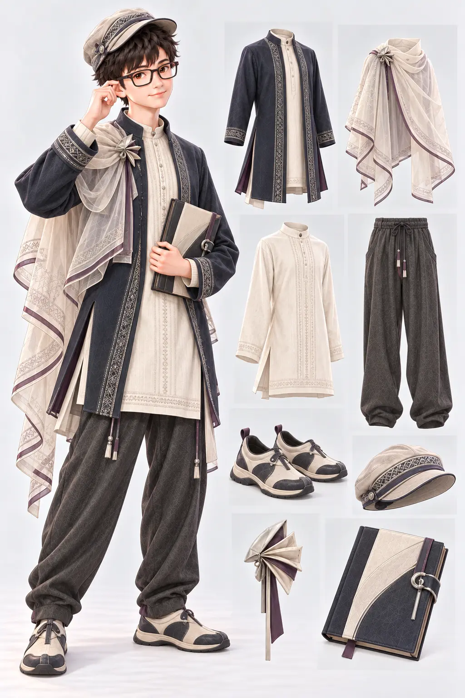

# Lv70 最終概念：餘光檔案

狀態：玩家已確認這張融合印度服裝語彙的最終概念，八欄造型已加入等級衣櫥。本頁是原創八欄設計規格，不是可直接裁切的透明裝備素材。專案只保留修改後的[最終概念圖](../../game/assets/equipment/level70-requiem.webp)。



## 來源與分析界線

- 音樂：莫札特《D 小調安魂曲》K. 626 的完整〈Lacrimosa／落淚之日〉樂章，採傳統蘇斯邁爾續成版本。[莫札特基金會作品目錄](https://kv.mozarteum.at/en/work/requiem-the-requiem-completed-by-franz-xaver-susmayr-in-the-traditional-form-7373)說明作品未完成，以及兩位作者的關係。
- 參考錄音：[Josef Krips 1950 年錄音，Wikimedia Commons](https://commons.wikimedia.org/wiki/File:Mozart_-_Requiem_(Krips)_-_VIII._Lacrimosa.flac)，長 233 秒。Commons 標示歐盟錄音鄰接權已屆滿；音檔只存本地作設計參考，**不放入遊戲或網站**。本地 SHA-256：`1545102cea0b09328a352acf3a950509f53fd241f1f31f9dc8977df477fb7755`。
- [全長訊號掃描](full-recording-scan.json)覆蓋 10,275,300／10,275,300 幀。四個四分段平均 RMS：0.05976、0.07248、0.05552、0.09893；第 58 秒最強，第 232 秒最弱。這是訊號測量，**並非親耳聽完**。
- 印度服裝參考：[V&A 的印度紡織研究](https://www.vam.ac.uk/articles/indian-textiles/)說明 tunic／trouser 組合與現代轉譯；[V&A 的刺繡研究](https://www.vam.ac.uk/articles/indian-embroidery)用於理解細密布面工法。僅取一般剪裁、披搭與手織質感；圖案另行原創，避開宗教與特定社群標誌。

## 視覺轉譯

合唱與管弦的多層編制，轉為可拆的薄披布與長上衣疊層；末段較強的音量輪廓，轉為深墨藍外層露出象牙白中層；末秒安靜收束，轉為簡潔的側開衩線條與閉合研習冊。這些都是設計比喻，不是錄音客觀具有的顏色或服裝形狀。

主色深墨藍、炭灰、骨白，少量灰紫和霧銀。普通／稀有／史詩／極品只由遊戲介面邊框、符號和文字標記，衣料配色不代表品質。

| 欄位 | 最終造型與材料 | 前／側／後和裝配重點 |
| --- | --- | --- |
| 外套 | 有袖霧面深藍長外套，受 kurta 長襬和側開衩啟發，原創細線刺繡邊 | 側開衩須在側視連續；後視長襬不與披布黏合；前視露出內層上衣 |
| 披風 | 受 dupatta 披搭啟發的獨立半透明短肩披，骨白薄棉紗與灰紫邊 | 肩扣獨立於外套；側視見披布從單肩落下；後視有完整披搭路徑，卸下後外套仍完整 |
| 上衣 | 骨白立領長上衣，手織感棉布、少量原創同色直向小線紋 | 前視長於外套開口；側視有明確側衩；後視素面，不生成宗教文字 |
| 褲子 | 炭灰寬鬆抽繩直筒褲，參考實用的 salwar／paijama 份量 | 前後視兩褲管完整；側視留膝部活動空間，不做舞台燈籠褲 |
| 鞋子 | 骨白與墨藍低筒步行鞋，鞋尖略圓，鞋底為現代耐走結構 | 前／側／後視鞋尖、鞋底、褲腳有清楚交界 |
| 帽子 | 中性低檐布帽，細小原創織紋 | 與眼鏡、頭髮分離；避免宗教頭飾或現成徽章 |
| 配戴物 | 抽象摺頁花瓣胸針，霧銀與灰紫，無宗教含義 | 固定胸前，可在沒有披風時辨識，不當作品質標誌 |
| 手持物 | 可開合的檔案研習冊，墨色與骨白封面，空白頁 | 左右手握持點、書冊厚度與開闔狀態另製；不生成假文字 |

避免骷髏、墓碑、宗教標誌、異國情調化、複製既有織物圖案、歌劇／演出服、品牌與武器。最終正式素材仍需逐件透明前／側／後視角及遊戲實測。

## 最終產圖記錄

- 工具：內建 `imagegen`；日期：2026-10-31。
- 編輯參考：本專案先前的 Lv70 概念圖，保留原創角色臉部和八欄版面，改做印度服裝概念。專案只存最終圖 `../../game/assets/equipment/level70-requiem.webp`。
- 最終生成原檔：`C:/Users/PC/.codex/generated_images/01a18ddb-788b-7421-9a91-e0d1372aac00/exec-62375311-747a-412c-b74c-bbef04f1a697.png`。

### 最終編輯提示詞

```text
Edit this existing LEVEL 70 game outfit concept sheet. Preserve the same friendly bespectacled young adult protagonist, original face and hair, softly realistic 3D storybook rendering, tall studio composition, eight separate item callouts, and core solemn-yet-hopeful abstract inspiration from Mozart Requiem Lacrimosa. REDESIGN the clothing to integrate carefully researched INDIAN GARMENT CONSTRUCTION in a contemporary, practical academy-archivist outfit: a long sleeved deep ink-navy jacket with kurta-inspired straight side-slit hem and narrow standing collar, worn over a separate ivory long tunic shirt with subtle handloom-cotton texture and original tone-on-tone small embroidery-like linear stitchwork; a separate removable translucent dupatta-inspired shoulder drape (the CAPE slot) crossing one shoulder and returning at the back, visibly independent from the jacket and shirt; charcoal relaxed straight drawstring trousers inspired by practical salwar/pajama volume while staying suitable for walking; durable low walking shoes with softly curved jutti-inspired toe but modern soles; a neutral low soft fabric cap with understated original woven pattern, no religious headdress; small abstract folded-page metal brooch; handheld blank academic archive folio. Keep palette ink navy, bone ivory, charcoal, tiny muted plum and subdued silver. Replace the previous ruffled cape and dangling long ribbons with clean drape and simple functional seams. Clearly show exactly EIGHT standalone pieces: sleeved jacket, separate cape/drape, shirt/tunic, trousers, shoes, cap, brooch, study folio. Keep visual distinction from Lv50 geometric and Lv60 sage outdoor suit. Respect India's diverse clothing traditions without treating them as a single costume. No sari imitation, sacred motifs, bindi, religious symbols, cross, skull, grave imagery, exaggerated exotic jewelry, stage costume, logo, readable text, music notes or weapons. This is ORIGINAL garment design, not a copy of a museum object, brand, celebrity, existing game character, or album cover. Do not add labels or text.
```
