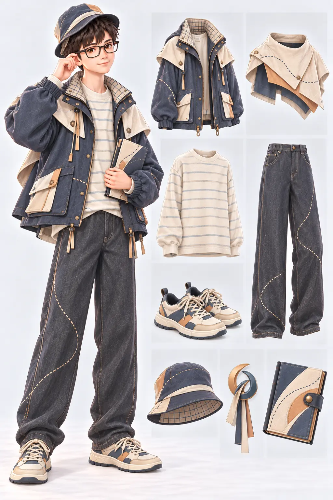
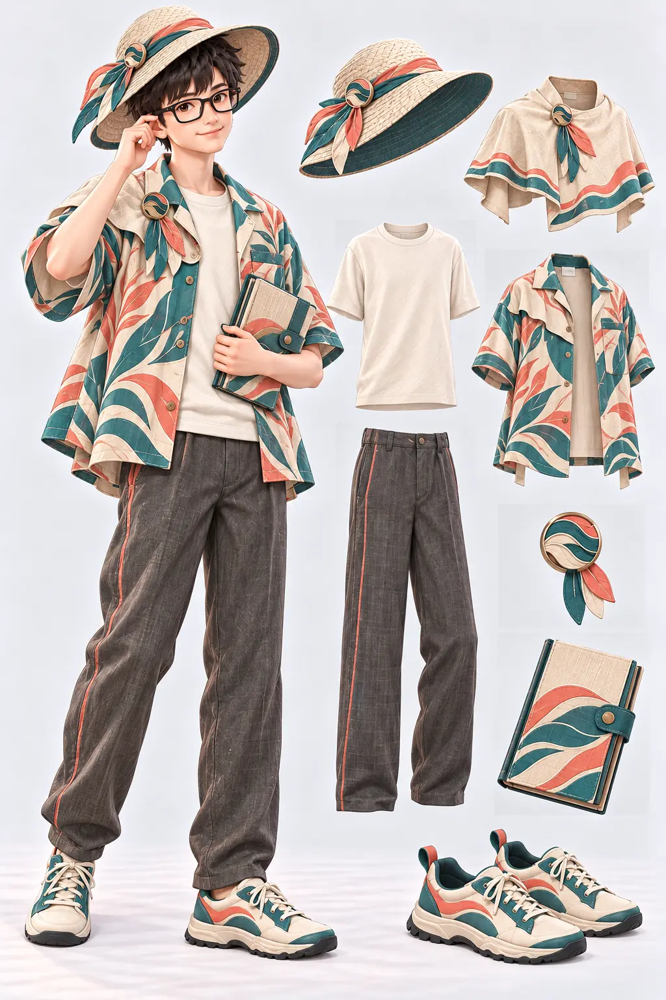

# Lv80／90 最終概念圖與八欄規格

狀態：兩張是玩家確認的**最終版概念圖**，各級只在專案保留一張最終圖，八欄造型已加入等級衣櫥。80 級先由歌曲形成基礎概念，再加入英國 1990 年代服裝元素；90 級先由歌曲形成基礎概念，再加入夏威夷服裝元素。概念板不是透明穿戴素材。

本次未取得可合法納入專案的完整歌曲錄音，也無直接聆聽能力；**沒有宣稱聽完整首或完成音訊掃描**。歌曲與服裝的連結是根據官方曲目資料、歌曲標題及藝術方向提出的暫定視覺詮釋。原始歌曲、歌詞、MV、演出服和唱片封面均未重製或放入遊戲。

## Lv80：每日來信



- 音樂來源：張雨生〈天天想你〉，1988 年同名專輯曲目；[滾石唱片官方音源頁](https://www.youtube.com/watch?v=0yZuyXFdVFs)與 [Apple Music](https://music.apple.com/us/album/%E5%A4%A9%E5%A4%A9%E6%83%B3%E4%BD%A0/1444826215)。歌名中的「天天」被詮釋為反覆出現的衣縫弧線，「想你」被詮釋為能往返開合的空白研習冊；這是創意比喻，**不是全曲聲音分析**。
- 英國 1990 年代參考：[V&A 的 90 年代服裝整理](https://www.vam.ac.uk/mused/fashion/best-fashion-moments-of-the-90s/)提及漁夫帽與街頭服飾；本設計只取寬鬆外套、直筒褲、帽型等一般輪廓，不使用任何樂團、名人、品牌或可辨認格紋。
- 主色暮藍、暖米白、石墨灰，少量杏色；以一條反覆出現的原創細縫線串聯物件，保留日常、溫暖、可閱讀的學院感。

| 欄位 | 最終造型與材料 | 三視圖／獨立穿戴要求 |
| --- | --- | --- |
| 外套 | 暮藍寬鬆短派克外套，霧面棉布；領內少量原創細格，不用品牌格紋 | 有袖、口袋與拉鍊；後視弧形細縫不中斷；披風拆下仍完整 |
| 披風 | 米白短肩防雨披片，摺信邊緣與杏色小塊 | 肩扣獨立；側視不遮住整條外套袖；後視止於上背 |
| 上衣 | 寬鬆米白細橫條針織衫 | 前視與外套領口分離；後視條紋對齊，不複製現成品牌 |
| 褲子 | 石墨灰寬直筒丹寧感布褲，一條反覆弧線細縫 | 正側後均留活動空間；不變成 Lv60 工作褲 |
| 鞋子 | 米白與暮藍低筒帆布步行鞋 | 正側後可辨鞋底與鞋帶；適合校園移動 |
| 帽子 | 軟質暮藍漁夫帽，內側原創細格 | 與眼鏡、頭髮避讓；不加樂團或品牌標誌 |
| 配戴物 | 雙弧書籤小胸針，杏色與暮藍 | 胸前固定；無披風時仍可辨識，不當作品質星記 |
| 手持物 | 可開合的往返研習冊，封面有單條弧形縫線 | 左右手持握點及空白內頁另製，不寫歌詞或假文字 |

## Lv90：海風切拍



- 音樂來源：依玩家提供「韓國最近流行曲、she so bad」選用 ATEEZ 2026 年歌曲〈BAD〉，玩家已接受此方向；[ATEEZ 官方 MV 頁](https://ateez-official.jp/movies/129627)核對正式曲名，[Apple Music 專輯頁](https://music.apple.com/us/album/golden-hour-part-5-ep/6770401924)稱其為帶 phonk 元素的主打。反覆切分的服裝縫線是設計詮釋，並非本次親耳聽完後的節奏測量。
- 夏威夷服裝參考：[檀香山藝術博物館「Fashioning Aloha」](https://honolulumuseum.org/fashioning-aloha-fmq7)說明 aloha wear 與服裝圖樣的多元來源；[夏威夷大學服裝史介紹](https://www.hawaii.edu/malamalama/2001/07/Fashion.html)說明本地穿著與襯衫發展。只取輕薄、通風的開領上衣與抽象海岸植物圖案，圖案重新繪製；不使用草裙、呼拉舞裝或神聖圖騰。
- 主色海藍綠、珊瑚、暖沙和骨白，以錯位波浪邊表現活力。Lv90 比 Lv80 更輕、更通風，與 Lv70 深色長上衣明顯區分。

| 欄位 | 最終造型與材料 | 三視圖／獨立穿戴要求 |
| --- | --- | --- |
| 外套 | 輕薄有袖開領 aloha 風格外襯，原創抽象葉與浪線印花 | 可單獨穿；前視開襟見內搭；側後視印花與袖口連續，不照搬現成花布 |
| 披風 | 骨白短肩遮陽披片，海藍綠與珊瑚波浪邊 | 獨立肩扣；外套脫下後仍可搭內搭；側後視短而透氣 |
| 上衣 | 素色骨白棉質短袖上衣 | 與外襯分件；正側後均維持素面留白 |
| 褲子 | 石墨沙色輕亞麻直筒褲，單側珊瑚細縫 | 膝部可活動；後視不變成笨重工作褲 |
| 鞋子 | 骨白與海藍綠低筒步行鞋 | 有實用鞋底與鞋帶，前側後視可辨，不用人字拖作戰鬥鞋 |
| 帽子 | 透氣軟檐遮陽帽，原創織感與細色帶 | 與 Lv80 漁夫帽分輪廓；眼鏡與頭髮避讓 |
| 配戴物 | 抽象海浪與書頁交疊的小胸針 | 固定於披片或外襯；縮小仍可辨，不等於品質符號 |
| 手持物 | 海岸植物研習冊，封面只有原創浪線圖形 | 左右手握持點、空白頁及關閉狀態另製；不放歌曲或表演影像 |

兩套的品質仍由遊戲 UI 邊框、符號和文字表示，不把服裝配色當作稀有度。玩家可保留低等級喜歡的風格，後續裝備培養不改外觀。正式實作前須有每件透明前／側／後素材、混搭遮擋檢查、舊存檔與多人／離線驗證。

## 最終產圖記錄

- 工具：內建 `imagegen`；日期：2026-10-31；角色畫風參考本專案 Lv60 原創角色。兩級各先有歌曲概念草稿，再編輯加入指定時代／地域元素；草稿**沒有保存到專案**。
- Lv80 最終圖：[../../game/assets/equipment/level80-letter.webp](../../game/assets/equipment/level80-letter.webp)；生成原檔：`C:/Users/PC/.codex/generated_images/01a18ddb-788b-7421-9a91-e0d1372aac00/exec-7e8b5806-e199-42a2-812f-32ceac9895c5.png`。
- Lv90 最終圖：[../../game/assets/equipment/level90-tide.webp](../../game/assets/equipment/level90-tide.webp)；生成原檔：`C:/Users/PC/.codex/generated_images/01a18ddb-788b-7421-9a91-e0d1372aac00/exec-d4abb218-a96c-48b0-bb26-1cf12dfc9a84.png`。

### Lv80 最終編輯提示詞

```text
Edit this LEVEL 80 music-inspired game equipment concept board into its SINGLE FINAL version, adding ORIGINAL 1990s BRITISH STREETWEAR elements after the existing 'Thinking of You Every Day' visual idea. Preserve the same young bespectacled protagonist and friendly softly realistic 3D storybook style, full-body left / eight separate item callouts right, the repeated curved stitch path suggesting daily memory, the soft dusk-blue, cream and apricot palette, the study correspondence journal, and all eight independent equipment slots. Redesign the garments noticeably: (1) a practical matte navy short parka-inspired sleeved jacket with roomy 1990s British streetwear cut, subtle original narrow woven check detail only inside the collar, not any brand tartan; (2) a detachable short cape/shoulder rain panel with a folded-letter edge, clearly separate from jacket; (3) cream relaxed knit or jersey shirt with fine understated horizontal striping; (4) loose straight-leg charcoal-blue denim-like trousers, no cargo overload; (5) low-profile canvas-style walking trainers; (6) soft bucket hat with no logo, clearly distinct from previous peaked cap; (7) small abstract double-arc bookmark badge, no lettering; (8) blank academic correspondence journal with one apricot recurring-seam motif. 1990s UK elements should be modest and wearable, like period street casual / Britpop-adjacent silhouettes, NOT any named musician or band's look. Reduce dangling ribbons, decorative gold, giant layered flounces, and technical-fantasy cutouts so it reads as everyday retro study clothing, not the Level 60 outdoor or Level 70 Indian-inspired outfit. Avoid Union Jack, recognisable tartans, Burberry checks, named brands, album covers, singer likeness, song lyrics, music notes, instruments, text, weapon, watermark. All garment patterns are newly invented. No labels or UI.
```

### Lv90 最終編輯提示詞

```text
Edit this LEVEL 90 concept into its SINGLE FINAL HAWAIIAN-INSPIRED VERSION, keeping the same original bespectacled game protagonist, the eight separated equipment callouts and the energetic offset-stitch visual rhythm inspired abstractly by ATEEZ's song BAD. Transform the heavy technical outerwear into practical contemporary aloha wear for a warm-weather pharmacy field-study adventure, informed by Hawaiian clothing history without copying any existing aloha shirt print or sacred cultural symbol. Exactly eight individually detachable items: (1) lightweight teal and warm-cream sleeved open camp-collar aloha-jacket with an ORIGINAL restrained abstract coastal leaf-and-wave print in coral, not a branded shirt; (2) a separate short breathable shoulder sun-cape/sun-shawl in cream with staggered wave-border, clipped at the shoulder, clearly not sewn to jacket; (3) simple ivory inner cotton shirt; (4) airy charcoal-sand straight linen trousers with one offbeat coral seam, not heavy cargo pants; (5) low white/teal canvas walking shoes with practical soles; (6) a soft woven-look brimmed sun hat, NOT the prior level-80 bucket hat; (7) small original abstract tide-and-page brooch; (8) blank coastal botanical study notebook with subtle matching wave rhythm. Keep teal, coral, sand, cream and a small charcoal anchor. Show a clean full-body figure left, eight isolated matching item callouts right, all clearly visible and consistent. Mood lively, breezy and academic; different from Lv70 dark Indian drape and Lv80 British 1990s parka. Remove all long dangling straps, armor-like panels, stage performance cues and overbuilt boots. No grass skirt, hula costume, lei, tiki, sacred motifs, copyrighted prints, brand marks, K-pop group or member likeness, album cover, MV imagery, music notes, song words, readable text, weapons, UI or watermark. Original clothing design and polished softly realistic 3D storybook rendering.
```
