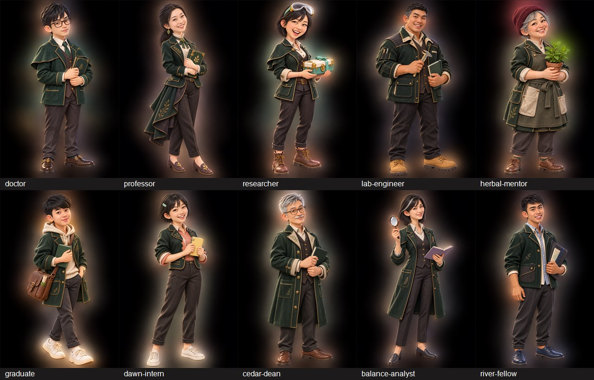

# 交線學院 COMMON｜十位角色正面進度

本頁是 2026-11-15 的隔離美術進度預覽。十位角色各有以遊戲原始肖像為基礎的正面服裝候選；每位使用相同系列語彙與自己的服裝輪廓。原始角色圖未覆蓋。博士正面方向曾經使用者確認，其餘角色仍須目視驗收。

雲端分支提供 JPEG 預覽；高解析 PNG、遮罩與製作腳本仍保存在本機隔離副本，沒有接入正式遊戲。

個別放大檢視：[博士](original-character-review/cloud-doctor.jpg) · [教授](original-character-review/cloud-professor.jpg) · [研究員](original-character-review/cloud-researcher.jpg) · [工程師](original-character-review/cloud-lab-engineer.jpg) · [草藥導師](original-character-review/cloud-herbal-mentor.jpg) · [畢業生](original-character-review/cloud-graduate.jpg) · [實習生](original-character-review/cloud-dawn-intern.jpg) · [院長](original-character-review/cloud-cedar-dean.jpg) · [分析師](original-character-review/cloud-balance-analyst.jpg) · [研究夥伴](original-character-review/cloud-river-fellow.jpg)。

這些圖片是 **正面原畫候選**，不是遊戲裝備成品。目前缺少合格的四方向、八欄可穿脫分件、RUN8 與商城／背包／場景實際 UI 驗證。原有遊戲入口與玩家資料不變；本分支只保存製作進度，不代表正式發布。

逐人來源與缺件見 [CAST_ART_COVERAGE.json](CAST_ART_COVERAGE.json)，退件原因見 [RUNTIME_ART_GAP.md](RUNTIME_ART_GAP.md)。
